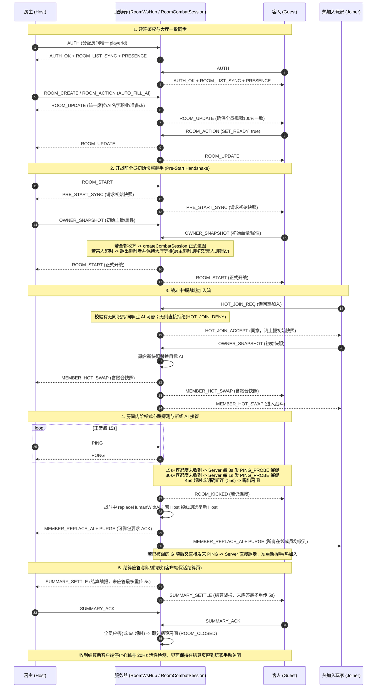
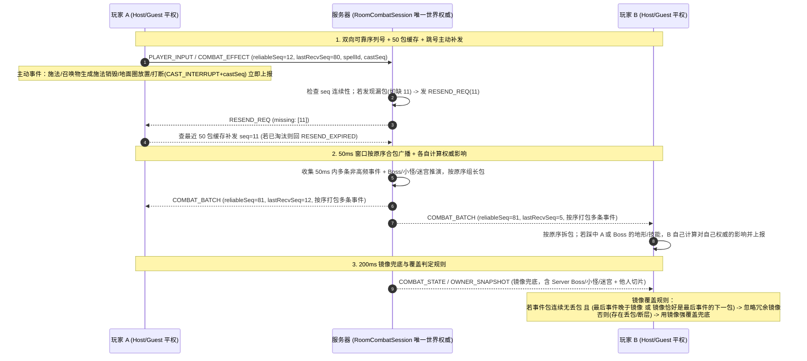
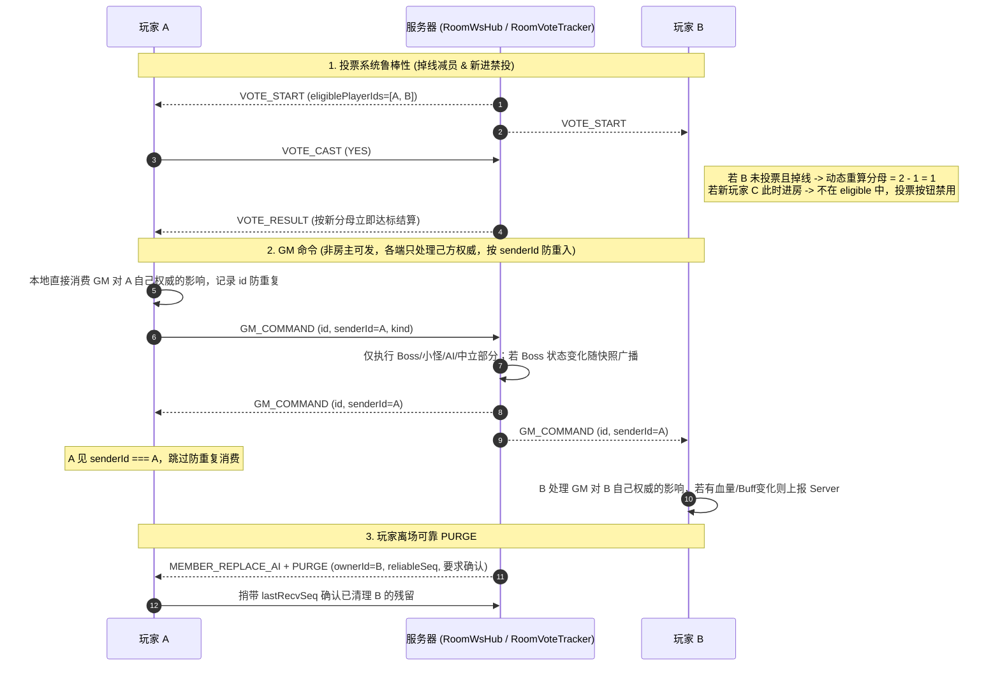

# L1 域指南：网络通信架构、三端权威边界与同步时序（Network & Sync · V2 定稿）

> **上级入口**：`MASTER_INDEX.md`  
> **关联域指南**：`DOCS/domains/UI_AND_ROOMS.md`、`DOCS/domains/COMBAT_AND_CLASSES.md`、`DOCS/domains/DUNGEONS_AND_BOSSES.md`

---

## 1. 架构总览与核心代码索引

联机架构采用 **“Server 唯一世界权威 + 玩家分片权威（Sharded Authority）+ 战斗内 Host/Guest 完全平权”** 模型：
- **Server 唯一世界权威**：房间/大厅/投票/心跳/热加入/在场追踪、以及战斗中的 **Boss、小怪、AI 队友、迷宫（地形/小怪/墓碑）、世界快照与合包下发** 全部由服务端（`RoomWsHub` + `RoomCombatSession`）唯一负责。**彻底废除房主客户端本地推演世界并上行 `COMBAT_STATE`/`COMBAT_BATCH` 的旧兼容路径**。
- **战斗内 Host 与 Guest 完全平权**：房主仅在大厅（建房、配置、踢人、补 AI、开战）拥有管理权限；进入战斗后，Host 与 Guest 行为 100% 一致，均接收 Server 下发的世界状态与批处理包。
- **真人玩家分片权威**：无论 Host 还是 Guest，**仅对自己操控的角色、自己召唤的宠物、自己放置的地面圈/图腾**拥有权威。任何人（含 Server 管理的 Boss/小怪）踩到他方地形或承受他方效果时，由**目标所属权威端**独立计算对自己权威的影响并上报。
- **统一双向可靠传输与 50ms 合包**：除高频移动（玩家移动、召唤物移动）外，**所有非高频消息（双向上行与下行）统一采用单调递增 `reliableSeq` + 捎带 `lastRecvSeq`（双向确认）+ 50 包缓存 + 跳号主动请求补发（含过期响应）**；Server 在 **50ms（对齐 20Hz Tick）** 窗口内按严格先后顺序将多条消息合包下发，接收端按原序拆包。

| 模块 | 路径 | 核心职责 |
|---|---|---|
| **网络协议定义** | `DEV/packages/engine/src/net/NetProtocol.ts` | 全部 WS 消息枚举、统一可靠信封（`reliableSeq`/`lastRecvSeq`）、载荷结构、投票多数决纯函数 |
| **WS 枢纽与路由** | `DEV/packages/server/src/roomWs.ts` | `RoomWsHub`：鉴权、阶梯式心跳与幽灵重连踢出、开战前快照握手、房间生命周期、投票调度、消息合包与路由 |
| **服务端战斗会话** | `DEV/packages/server/src/RoomCombatSession.ts` | 服务端 20Hz `CombatEngine` + `RunStateMachine`（Boss/小怪/AI/迷宫唯一权威）、50 包重传缓存、`COMBAT_BATCH`/`COMBAT_STATE` 广播 |
| **服务端投票追踪** | `DEV/packages/server/src/roomVotes.ts` | `RoomVoteTracker`：10s 跳过行军与 15s 灭团计时、动态掉线减员重算分母、新进禁投校验 |
| **客户端 WS 封装** | `DEV/packages/web/src/net/NetClient.ts` | 自动重连、心跳应答、统一 `reliableSeq`/`lastRecvSeq` 50 包缓存与跳号 `RESEND_REQ` |
| **客户端同步总入口** | `DEV/packages/web/src/hooks/useNetworkRoomSync.ts` | 消费全部下行消息（含 `ROOM_CHAT`、`PURGE`、`RESEND_*`）、事件 vs 镜像兜底判定、热加入与结算保持 |
| **分片权威总线** | `DEV/packages/web/src/combat/networkCombatAuthority.ts` | `publishCombatEffect`、`ingestCombatEffect`、`buildLocalOwnerSnapshot`、`applyCombatBatch` |
| **权威保护守卫** | `DEV/packages/web/src/combat/hostAuthorityTickGuard.ts` | `withHostAuthorityOnlySim`：Tick 期间冻结非本地权威单位与地面效果（Host 与 Guest 逻辑完全一致） |
| **客户端帧循环** | `DEV/packages/web/src/combat/runCombatTick.ts` | 20Hz 本地玩家/宠物推演、`OWNER_SNAPSHOT` 发布、按 `moveSpeed` 平滑插值远端移动 |

---

## 2. 纵向分析：服务器 / 房主（Host） / 客人（Guest）权威与责任边界

### 2.1 三端核心权威与职责对照

| 维度 | 服务器（Server：`RoomWsHub` + `RoomCombatSession`） | 房主（Host 客户端） | 客人（Guest 客户端） |
|---|---|---|---|
| **连接与身份** | **唯一权威**：分配房间内永不复用的唯一 `playerId`（非座位号）；校验 `AUTH`、顶号 `SESSION_KICKED`；阶梯心跳探测（15s→每3s催→30s后每1s催→45s踢）；踢出后拒绝幽灵 `PING` | 普通已鉴权会话；被踢出后需重新握手进房（或热加入） | 与 Host 完全一致 |
| **房间与大厅** | **唯一权威**：`RoomManager` 管理建房/加房/退房/踢人/换专精/切图/难度/一键 AI/开战握手校验，统一经 `ROOM_UPDATE` 同步全员席位、AI 名字职业与准备态 | 大厅阶段可建房、调配置、踢人、补 AI、点开战；离房时若有他人则由 Server 移交房主，否则销毁 | 大厅阶段可入房、退房、改自身准备态、申请热加入队列 |
| **投票系统** | **唯一权威**：`RoomVoteTracker` 托管计时、计票；投票中新进者无权；已投掉线保留票数；未投且有资格者掉线时动态扣减分母重算半数 | 与 Guest 完全一致：有资格时提交投票，等待 `VOTE_RESULT` | 与 Host 完全一致：有资格时提交投票，等待 `VOTE_RESULT` |
| **Boss / 小怪 / AI 队友 / 迷宫** | **唯一权威**：运行 20Hz 引擎驱动 BossAI、副本小怪、AI 队友、DBM、Boss 召唤物/地形、迷宫生成与小怪墓碑，广播全员 | **零权威（纯镜像）**：与 Guest 完全一致，仅接收 Server 下发并渲染 | **零权威（纯镜像）**：与 Host 完全一致，仅接收 Server 下发并渲染 |
| **真人玩家 / 宠物 / 己方地形** | 接收并聚合：不直接篡改真人权威数据；当 Boss/小怪踩到玩家地形或受玩家效果时，由 Server 计算对 Boss/小怪的影响 | **仅对自己角色、自己宠物、自己地形有权威**：主动发事件上报，200ms 切片兜底；踩到敌方地形时自己计算扣血并上报 | 与 Host 完全一致 |
| **可靠性与防重放** | 与客户端**对称**：非高频包统一带 `reliableSeq` + `lastRecvSeq`，保留最近 50 包缓存；收到 `RESEND_REQ` 补发或回 `RESEND_EXPIRED`；50ms 窗口按原序合包分发 | 与 Guest 完全一致（**不再存在**客户端向房主上报或房主回 ACK） | 与 Host 完全一致：非高频包带 `reliableSeq` + `lastRecvSeq`，保留最近 50 包缓存，跳号主动请求补发 |

### 2.2 Host 与 Guest 行为差异专项对照表

> **核心结论**：进入战斗后，**Host 与 Guest 行为 100% 一致，无任何权威或协议差异**；所有差异仅存在于大厅组队阶段。

| 阶段 | 对比项 | 房主（Host） | 客人（Guest） |
|---|---|---|---|
| **大厅阶段** | 房间配置与开战 | 可建房、切图、改难度、一键补 AI、踢人、发起开战 | 仅可加入/离开房间、切换自身准备态、修改自身专精、申请热加入 |
| **大厅阶段** | 离房/超时后果 | 房间有其他真人则 Server 自动移交房主权（`HOST_TRANSFER`）并广播；无真人则销毁房间 | 仅释放席位（战斗中转 AI），房间保留 |
| **战斗阶段** | 所有战斗/迷宫/热加入/在场追踪/快照/可靠重传 | **与 Guest 完全一致**（仅对自己+宠物+己方地形有权威，全部世界数据由 Server 下发） | **与 Host 完全一致** |

---

## 3. 纵向时序：建连、开战握手、热加入、阶梯心跳与结算

---

## 4. 横向分析：全量网络同步对象矩阵（按产生角色逐行拆分）

> 说明：
> - 除高频移动（玩家移动、召唤物移动）外，**所有非高频消息均携带双向可靠 `reliableSeq` + `lastRecvSeq`**，发送端保留最近 50 包缓存，接收端跳号主动请求 `RESEND_REQ`（缓存淘汰则回 `RESEND_EXPIRED`）。
> - 同一同步对象若可由不同角色产生，从第 2 列「产生角色」起逐行拆分。

| 同步对象 | 产生角色 | 协议消息与核心字段 | 发送方向 | 完整流转过程与各端影响说明 | Server 响应 | Host 响应 | Guest 响应 |
|---|---|---|---|---|---|---|---|
| **房间管理** | **Host** | `ROOM_CREATE` / `ROOM_ACTION` (`AUTO_FILL_AI`, `ADD_AI`, `KICK`, `SWITCH_MAP`, `SET_DIFFICULTY`) / `ROOM_START` / `ROOM_LEAVE` | Host → Server → 全员 | Host 在大厅发起建房/配 AI/切图/开战 → Server 校验并统一通过 `ROOM_UPDATE` 广播全员，保证全员看到的席位、AI 名字职业、准备态一致；若 Host 离房且仍有他人则移交房主并广播，无真人则销毁房间 | 校验权限、更新 `RoomManager` 并广播 `ROOM_UPDATE` / `HOST_TRANSFER` / `ROOM_CLOSED`；开战触发 `PRE_START_SYNC` | 刷新本地房间大厅界面（席位/AI/配置）；开战收集快照后切入副本界面 | 刷新本地房间大厅界面，确保与房主看到完全一致的席位、AI 与配置 |
| ↳ **房间管理** | **Guest** | `ROOM_JOIN` / `ROOM_LEAVE` / `ROOM_ACTION` (`SET_READY`, `CHANGE_SPEC`) | Guest → Server → 全员 | Guest 加入、准备或离开 → Server 校验人数与配额 → 广播 `ROOM_UPDATE`；全员实时同步准备状态与席位空缺 | 校验配额并更新 `RoomManager`，广播 `ROOM_UPDATE` | 刷新房间内 Guest 的准备状态与席位 | 刷新自身准备按钮与大厅房间视图 |
| **热加入接管** | **Joiner (新玩家)** | `HOT_JOIN_REQ` → `HOT_JOIN_ACCEPT`/`DENY` → `OWNER_SNAPSHOT` → `MEMBER_HOT_SWAP` | Joiner ↔ Server → 全房 | 新玩家先询问热加入 → Server 校验有无同职责/同职业 AI 可替（无则直接 `HOT_JOIN_DENY` 拒绝，不打扰战局）→ 同意后新玩家上报初始快照 → Server 融合新快照并广播 `MEMBER_HOT_SWAP` 给全员与新玩家 → 新玩家进入战斗 | 严格校验可替 AI；收到新快照后替换引擎内 AI 并广播全房 | 收到 `MEMBER_HOT_SWAP` 移除被替 AI、合入新玩家镜像 | 与 Host 完全一致（新玩家自己则初始化副本并进入战斗） |
| **在线与心跳（房间内）** | **Host / Guest** | `PING` / `PONG` / `PING_PROBE` / `ROOM_KICKED` | Client ↔ Server | 房间内每 15s 常规 `PING`；15s+容忍未收 → Server 每 3s 发 `PING_PROBE` 催促；30s+容忍未收 → 每 1s 催促；45s 超时或断连 >5s → 发 `ROOM_KICKED` 踢出房间并重整房间（无活人销毁/战斗转 AI/大厅空位/房主移交）；若已被踢客户端后续误发 `PING` 直接踢走，须重新握手 | 阶梯探测、超时踢出、重整房间、广播 `MEMBER_REPLACE_AI` + 可靠 `PURGE`（或 `HOST_TRANSFER`） | 收到 `PING_PROBE` 立即回 `PING`；收到他人被踢包则清理该玩家残留 | 与 Host 完全一致 |
| **投票系统** | **Server** | `VOTE_START` / `VOTE_STATE` / `VOTE_RESULT` | Server → 房间 | 灭团自动发起 15s 投票（或 10s 跳过投票）→ 期间新进入者无投票权（按钮禁用）；已投者掉线保留其票；未投且有资格者掉线时重算半数分母（`初始有资格人数 - 未投且掉线人数`）→ 达半数/全员投完/超时裁决 | `RoomVoteTracker` 托管计时、动态分母重算、裁决并执行阶段切换 | 弹出/刷新/关闭投票面板（无资格者禁用按钮） | 与 Host 完全一致 |
| ↳ **投票系统** | **Host / Guest** | `VOTE_CAST` | Client → Server → 房间 | 有资格的真人点击同意/反对 → Server 校验资格记票 → 广播最新 `VOTE_STATE` 或 `VOTE_RESULT` | 校验资格并记票，提前达标立即裁决 | 更新已投状态与票数进度 | 与 Host 完全一致 |
| **结算与战报** | **Server** | `SUMMARY_SETTLE` / `SUMMARY_ACK` / `ROOM_CLOSED` | Server ↔ 全房 | 通关或灭团后 Server 下发 `SUMMARY_SETTLE`（含完整战报与证书数据）→ 收到全员 `SUMMARY_ACK` 后**即刻销毁房间**（未应答者最多重传 5s 后销毁）；客户端收到结算后停止心跳与 20Hz 活性检测，界面一直保留在结算页直到玩家手动关闭 | 下发结算并等待全员 ACK（最长 5s 重传），随后销毁房间 | 立即回 `SUMMARY_ACK`、停心跳与 20Hz 检测、保持在结算页直到手动关闭 | 与 Host 完全一致 |
| **Boss 本体与机制** | **Server** | `COMBAT_STATE` (`units`, `casts`, `bossTargetId`, `bossOverheadSkillName`, `extraAction`, `dbmAlerts`, `groundEffects`) | Server → 房间 | **仅 Server 权威**：Server 推演 Boss 血量/技能/头顶技能名/读条/DBM/Boss 召唤物/Boss 地形并广播；玩家对 Boss 的效果由 Server 结算；**玩家踩到 Boss 地形时，由玩家自己计算对自己权威的影响并上报** | 唯一推演 BossAI、仇恨、DBM、Boss 召唤物与地形 | 纯镜像渲染 Boss 血量/读条/头顶技能名/DBM/地形；踩圈自算并上报 | 与 Host 完全一致 |
| **敌方与迷宫小怪** | **Server** | `COMBAT_STATE` (`units` 中 `ADD`, `mazeSeed`, `mazeDungeonId`, `mazeStageIndex`, `mazeTrash`, `mazeLeadDist`, `mazeSctEvents`) | Server → 房间 | **仅 Server 权威**：Server 生成并模拟迷宫地形、小怪与墓碑并广播全员；玩家在迷宫中仍保有自身权威（血量/技能/Buff），释放技能或受影响后按战斗流程上报 Server | 生成迷宫与小怪、推进战斗与墓碑状态并广播 | 重建同构迷宫并镜像小怪与墓碑；自身技能/Buff/血量变化照常上报 | 与 Host 完全一致 |
| **玩家移动** | **Host / Guest** | `PLAYER_INPUT` (`kind: 'MOVE'`, `x`, `y`, `moveSpeed`, `atMs`) + `OWNER_SNAPSHOT` | 发起方 → Server → 房间 | 高频不带 `reliableSeq`，携带 `moveSpeed` 与时间戳；接收方收到多个移动包/镜像坐标时按时间戳排序，以 `moveSpeed` 依次平滑跑过去；若仅有一个包且未到达目标点，则以 `moveSpeed` 跑过去；200ms 切片兜底位置 | 更新引擎坐标并合包转发 | 自身移动即时生效；他人坐标按时间戳+`moveSpeed` 平滑移动 | 与 Host 完全一致 |
| **技能释放与打断** | **Host / Guest** | `PLAYER_INPUT` (`CAST`/`GROUND_CAST`/`DISPEL`/`EXTRA_ACTION`)、`CAST_INTERRUPT` (`unitId`, `spellId`, `castSeq`) | 发起方 → Server → 房间 | 玩家乐观读条（每次施法分配递增 `castSeq`）并走可靠序列号上行 → Server 确认并 50ms 合包广播；打断由**施法方自己权威生成** `CAST_INTERRUPT`（带 `castSeq`）→ 非权威方仅在当前绘制读条的 `castSeq` 匹配时才杀读条 | 确认可靠序列号；`EXTRA_ACTION` 由 Server 触发；转发读条与打断 | 自己管自己读条与打断；他人读条按 `castSeq` 精确同步与中止 | 与 Host 完全一致 |
| **光圈地形与图腾** | **Host / Guest** | `COMBAT_EFFECT` (`GROUND_PLACE`/`GROUND_DESPAWN`) + `OWNER_SNAPSHOT` (`groundEffects`) | 权威方 → Server → 房间 | 玩家放图腾/法阵时**主动发可靠事件**（受 `reliableSeq` 确认保护），同时 Server 在全局镜像中拼包兜底；**任何单位（含 Server 管的 Boss/小怪）踩到该地形，由目标所属权威端独立计算对自己权威的影响并上报** | 确认可靠序列号；计算该地形对 Boss/小怪的影响；拼入全局镜像兜底 | 保留自己权威圈；合并他人圈并计算他人圈对自己权威的影响后上报 | 与 Host 完全一致 |
| ↳ **光圈地形与图腾** | **Server** | `COMBAT_EFFECT` (`GROUND_PLACE`) + `COMBAT_STATE` (`groundEffects`) | Server → 房间 | Server 生成 Boss 毒圈/扇形预警，主动发事件并写入全局镜像兜底；玩家踩中后由玩家自己算扣血/Debuff 并上报 | 生成敌方预警圈并计算对 AI 队友的影响 | 渲染敌方预警圈；若自己踩中则自己算伤并上报 | 与 Host 完全一致 |
| **Buff / Debuff / 伤疗** | **Host / Guest** | `COMBAT_EFFECT` (`DAMAGE`, `HEAL`, `APPLY_BUFF`, `REMOVE_BUFF`, `DISPEL`, `RESOURCE`, `RESURRECT`, `TAUNT`, `AOE_PULSE`) | 施法方 → Server → 房间 | 施法方算值（仅传 `spellId` 不传 `spellName`）并走可靠包发出 → 仅**目标所属权威端**按 `effectId` 幂等落地并上报状态变化；Server 在 50ms 内合包广播 | 若目标为 Boss/AI/小怪则幂等落地；合包转发给全员 | 若目标为自己/自己宠物则幂等落地并上报；否则播特效等镜像 | 与 Host 完全一致 |
| **GM 命令** | **Host / Guest（无需限房主）** | `GM_COMMAND` (`id`, `senderId`, `kind`, 参数) | 发起方 → Server → 全房 | 任一玩家可发起 GM 命令（带唯一 `id` 防重传重复、`senderId` 防重入）；**发起方本地直接消费自己权威部分**；Server 处理 Boss/小怪/AI/中立部分并广播全房；各端收到后若 `senderId === self` 跳过自身已消费部分，其余端处理自己权威部分，有变化（血量/Buff）则各自上报 | 幂等去重 `id`；仅执行 Boss/小怪/AI/副本中立部分并广播全房 | 若是自己发出的跳过重复消费；否则仅处理自己权威部分并上报变化 | 与 Host 完全一致 |
| **召唤物** | **Host / Guest** | `COMBAT_EFFECT` (`SUMMON_SPAWN`/`DESPAWN`/施法/受击)、`SUMMON_MOVE`、`OWNER_SNAPSHOT` | 召唤者 → Server → 全房 | 玩家召唤物的**生成、施法、移动、销毁均主动触发事件上报**（不能干等 200ms 镜像，镜像仅兜底）；召唤物移动为高频包可不带 `reliableSeq`；对他人产生的伤疗/Buff 按常规事件由目标权威端处理上报 | 合并宠物状态与事件；若宠物攻击 Boss/小怪由 Server 落地结算 | 自己召唤物自己权威推演并主动上报；他人召唤物按事件+镜像更新 | 与 Host 完全一致 |
| ↳ **召唤物** | **Server** | `COMBAT_EFFECT` (`SUMMON_SPAWN`/`DESPAWN`)、`COMBAT_STATE` (`units`) | Server → 房间 | Boss/小怪/敌方召唤物可移动、可施法，全部由 Server 权威模拟并广播 | 驱动敌方召唤物 AI、移动与技能 | 纯镜像渲染；受到敌方召唤物攻击时按目标权威自算并上报 | 与 Host 完全一致 |
| **离场清理 (`PURGE`)** | **Server** | `PURGE` (`ownerId`, `reliableSeq`) + `OWNER_SNAPSHOT` (`purge: true`) | Server → 房间全员 | 有人离场/断线转 AI 时，除在镜像中带 `purge: true` 外，Server **单独向所有在线玩家发可靠 `PURGE` 包并要求确认**，防止丢包导致新玩家顶入后旧数据无法清理 | 发送可靠 `PURGE` 并跟踪各端 `lastRecvSeq` 确认，同时写入镜像 | 收到后彻底抹除该 `ownerId` 的单位、宠物与地面圈 | 与 Host 完全一致 |
| **房间聊天** | **Host / Guest / Server** | `ROOM_CHAT` (`id`, `senderId`, `senderKind`, `text`, `atMs`) | Client ↔ Server → 房间 | 发出方带唯一 `id` 与 `senderId` 上行 → Server 校验补时间戳后广播全房；前端消费 `ROOM_CHAT` 展示到聊天面板（发出方本地已显则按 `id`/`senderId` 去重） | 校验在房与长度、去重 `id` 并广播全房 | 消费下行 `ROOM_CHAT` 显示在聊天面板（按 `id` 去重） | 与 Host 完全一致 |

---

## 5. 横向时序：核心战斗、主动事件、镜像兜底与 GM 流转

### 5.1 横向时序 A：统一可靠序列号、50ms 合包、主动事件与镜像兜底

### 5.2 横向时序 B：投票动态分母、GM 分权消费与离场可靠 PURGE

---

## 6. 协议消息与核心字段字典（V2 目标规范）

### 6.1 统一消息信封 (`NetEnvelope<T>`) 与可靠传输层

> **设计原则**：不搞 `clientInputId` / `INPUT_ACK` 与 `seq` 两套重复机制，统一收口到信封层 `reliableSeq` + `lastRecvSeq`（双向对称保护）。

| 字段 | 类型 | 作用与说明 | 生成者 | 权威者 | 发送者 | 接收者 | 影响者（及影响内容） |
|---|---|---|---|---|---|---|---|
| `type` | `NetMessageType` | 消息类型枚举（含新增 `PRE_START_SYNC`、`HOT_JOIN_REQ`/`ACCEPT`/`DENY`、`PING_PROBE`、`ROOM_KICKED`、`PURGE`、`SUMMARY_SETTLE`/`ACK`、`RESEND_REQ`/`EXPIRED`） | 发送方 | 协议定义 | 双向 | 对端 | 路由到对应消息处理器 |
| `reliableSeq` | `number?` | 发送方单调递增序列号（每发一条非高频包 +1；高频移动包不带） | 发送方（Server / Client） | 发送方 | 双向 | 对端 | 接收方检测跳号并触发 `RESEND_REQ`；发送方缓存最近 50 包 |
| `lastRecvSeq` | `number?` | 捎带确认：发送方已**连续**收到对端的最大 `reliableSeq` | 发送方（Server / Client） | 发送方 | 双向 | 对端 | 对端据此推进确认水位、清理已确认的 50 包缓存，无需单独发冗余 ACK |
| `roomId` | `string?` | 所属房间 ID | 发送方 | Server | 双向 | 对端 | 房间隔离校验，丢弃跨房包 |
| `timeMs` | `number?` | 发送端毫秒时间戳 | 发送方 | 发送方 | 双向 | 对端 | 移动包排序、事件与镜像先后判定 |
| `payload` / `error` | `T?` / `string?` | 强类型载荷或错误描述 | 发送方 | 发送方 | 双向 | 对端 | 业务数据载荷 |

**补发协议**：
- `RESEND_REQ`：`{ missingSeqs: number[] }` — 接收方发现 `reliableSeq` 跳号时主动向发送方索要缺失包。
- `RESEND_EXPIRED`：`{ expiredSeqs: number[] }` — 发送方查 50 包缓存发现已淘汰时明确回复，防止接收方无限重试，通知接收方改用下一次镜像包强覆盖兜底。

### 6.2 房间、鉴权、心跳、热加入与结算消息摘要

| 分类 | 核心消息 | 关键规则与字段 |
|---|---|---|
| **鉴权与唯一 ID** | `AUTH` / `AUTH_OK` / `AUTH_FAIL` / `SESSION_KICKED` / `PRESENCE` | `playerId` 由 Server 按房间唯一分配，**绝不是座位号**，不同角色不可复用房间内已用过的 ID，进出广播全员 |
| **阶梯心跳** | `PING` / `PONG` / `PING_PROBE` / `ROOM_KICKED` | 15s 常规 → 15s+容忍每 3s `PING_PROBE` → 30s+容忍每 1s `PING_PROBE` → 45s 踢出；已踢客户端发来幽灵 `PING` 直接踢走 |
| **大厅与握手** | `ROOM_CREATE` / `JOIN` / `LEAVE` / `ACTION` / `UPDATE` / `PRE_START_SYNC` / `ROOM_START` / `ROOM_CLOSED` | `AUTO_FILL_AI`/`SET_READY` 全走 `ROOM_UPDATE` 同步；开战前先发 `PRE_START_SYNC` 收齐初始快照，超时踢出超时者并留在大厅 |
| **热加入与离场** | `HOT_JOIN_REQ` / `HOT_JOIN_ACCEPT` / `HOT_JOIN_DENY` / `MEMBER_HOT_SWAP` / `MEMBER_REPLACE_AI` / `HOST_TRANSFER` / `PURGE` | 热加入须校验有同职责/同职业 AI 可替，同意后上报快照再融合广播；离场发可靠 `PURGE` 要求确认 |
| **结算** | `SUMMARY_SETTLE` / `SUMMARY_ACK` | 全员 ACK 后即刻销毁房间（未 ACK 最多重传 5s）；客户端收到后停心跳与 20Hz 检测，停留在结算页直到手动关闭 |

### 6.3 战斗同步与分片权威消息（逐字段说明）

> **精简规则**：
> - 全局统一使用 `spellId`（客户端/服务端本地查 `ClassRegistry`/`SPELL_ID_TO_NAME` 得中文名），**不再传输 `spellName`**；
> - **不再传输 `slotIndex`**（他人和服务端无需关心玩家的快捷键位）；
> - **无 Host 兼容路径**：世界快照与合包唯一生成者为 **Server**，Host 与 Guest 地位完全一致。

#### 6.3.1 `PLAYER_INPUT`（玩家意图上行：`PlayerInputPayload`）

| 字段 | 类型 | 作用与说明 | 生成者 | 权威者 | 发送者 | 接收者 | 影响者（及影响内容） |
|---|---|---|---|---|---|---|---|
| `playerId` | `string` | 房间内唯一角色 ID（非座位号，永不复用） | 发起方客户端 | Server（按 `session` 强校验） | Client → Server → 房间 | Server、其他客户端 | 定位对应玩家单位 |
| `kind` | 枚举 | `CAST` / `GROUND_CAST` / `SUMMON` / `TARGET` / `INTERRUPT` / `MOVE` / `DISPEL` / `EXTRA_ACTION` / `READY` | 发起方客户端 | `EXTRA_ACTION` 归 Server；其余归发起方 | Client → Server → 房间 | Server、其他客户端 | 触发对应动作或转发 |
| `spellId` | `string?` | 技能唯一 ID（全局统一用 ID，不传 `spellName`） | 发起方客户端 | 发起方（额外动作归 Server） | Client → Server → 房间 | Server、其他客户端 | 查表显示与机制触发 |
| `castSeq` | `number?` | 施法方每次施法单调递增 +1 的序号 | 施法方客户端 | 施法方客户端 | Client → Server → 房间 | Server、其他客户端 | 绑定本次读条实例，供 `CAST_INTERRUPT` 精准匹配 |
| `targetId` | `string \| null?` | 指向的目标单位 ID | 发起方客户端 | 发起方客户端 | Client → Server → 房间 | Server、其他客户端 | 同步目标指向 |
| `x` / `y` | `number?` | 移动目标坐标或地面落点坐标（px） | 发起方客户端 | 发起方客户端 | Client → Server → 房间 | Server、其他客户端 | 移动或地面圈定位 |
| `moveSpeed` | `number?` | `MOVE` 时的移动速度（px/s） | 发起方客户端 | 发起方客户端 | Client → Server → 房间 | Server、其他客户端 | 接收方按时间戳排序并以 `moveSpeed` 依次平滑跑向目标点 |
| `spawnKind` | `'PET' \| 'ADD' \| 'NPC'?` | `SUMMON` 召唤物类型 | 发起方客户端 | 发起方客户端 | Client → Server → 房间 | Server、其他客户端 | 识别召唤物类别 |

#### 6.3.2 `COMBAT_EFFECT`（分片战斗效果事件：`CombatEffect`）

| 字段 | 类型 | 作用与说明 | 生成者 | 权威者 | 发送者 | 接收者 | 影响者（及影响内容） |
|---|---|---|---|---|---|---|---|
| `effectId` | `string` | `${sourceId}_${epoch}_${seq}` 全局幂等去重键 | 施法方客户端 / Server | 接收端各自去重 | 发起方 → Server（50ms合包）→ 全房 | Server、所有客户端 | 防止重复扣血/加血/上 Buff |
| `sourceId` / `targetId` | `string` | 发起者与承受者 ID | 施法方 / Server | 目标所属权威端 | 发起方 → Server → 全房 | Server、所有客户端 | 仅目标权威端落地修改 HP/Buff 并上报 |
| `spellId` | `string` | 技能唯一 ID（不传 `spellName`） | 施法方 / Server | 施法方 / Server | 发起方 → Server → 全房 | Server、所有客户端 | 统计归因、飘字与图标查表 |
| `castSeq` | `number?` | 关联的施法序号（用于 `CAST_START`/`CAST_LAND`） | 施法方 | 施法方 | 发起方 → Server → 全房 | 所有客户端 | 绑定读条实例，防同名技能错乱 |
| `kind` | 枚举 | `DAMAGE` / `HEAL` / `APPLY_BUFF` / `REMOVE_BUFF` / `RESOURCE` / `RESURRECT` / `INTERRUPT` / `SUMMON_SPAWN` / `SUMMON_DESPAWN` / `CAST_START` / `CAST_LAND` / `AOE_PULSE` / `GROUND_PLACE` / `GROUND_DESPAWN` / `DISPEL` / `TAUNT` | 施法方 / Server | 施法方算事件，目标权威端落地状态 | 发起方 → Server → 全房 | Server、所有客户端 | 触发对应血量/Buff/召唤物/地面圈更新 |
| `amount` / `isCrit` | `number?` / `boolean?` | 伤害/治疗数值与暴击标记 | 施法方 / Server | 施法方算值，目标权威端落地 | 发起方 → Server → 全房 | Server、目标权威端 | 目标真实 HP/Absorb 与飘字 |
| `buff` | `CombatEffectBuffPayload?` | `APPLY_BUFF` 详情（`spellId`, `kind`, `tags`, `stacks` 绝对层数, `maxStacks`, `durationMs`, `moveSpeedMod`, `sharedTimer`） | 施法方 / Server | 目标权威端 | 发起方 → Server → 全房 | Server、目标权威端 | 更新目标 `buffs[]` 与移速 |
| `removeSpellId` | `string?` | `REMOVE_BUFF`/`DISPEL` 移除的技能 ID | 施法方 / Server | 目标权威端 | 发起方 → Server → 全房 | Server、目标权威端 | 移除对应光环 |
| `x` / `y` / `radius` / `groundEffectId` / `groundKind` / `colorHex` / `remainingMs` / `tickIntervalMs` / `tickValue` / `facingRad` / `coneAngleRad` | 地面与空间参数 | 地面圈稳定 ID、坐标、半径、类型、跳伤与扇形参数 | 放置方（玩家 / Server） | 放置方拥有区域生命周期；区域内目标由**目标权威端**自算影响 | 放置方 → Server → 全房 | Server、所有客户端 | 全端同步渲染该地形；Server 算其对 Boss/小怪影响，玩家算其对自己影响并上报 |
| `spawnedUnitId` / `resourceKind` / `resourceDelta` / `totalMs` / `isChannel` / `interruptible` / `visualTone` | 专项载荷 | 召唤物 ID、资源增减、读条时长与视觉色调 | 发起方 / Server | 发起方（资源落地归目标权威端） | 发起方 → Server → 全房 | Server、所有客户端 | 召唤物关联、资源变动、读条条与特效 |

#### 6.3.3 `CAST_INTERRUPT`（施法方权威打断通知）

| 字段 | 类型 | 作用与说明 | 生成者 | 权威者 | 发送者 | 接收者 | 影响者（及影响内容） |
|---|---|---|---|---|---|---|---|
| `unitId` | `string` | 被打断读条的施法单位 ID | **施法方自己**（或 AI/Boss 归 Server） | **施法方自己**（AI/Boss 归 Server） | 施法方 → Server（可靠确认并广播）→ 全房 | Server、其他客户端 | 通知非权威方中止绘制该单位的读条条 |
| `spellId` | `string` | 被打断的技能 ID | 施法方自己 | 施法方自己 | 施法方 → Server → 全房 | 其他客户端 | 辅助标识 |
| `castSeq` | `number` | **核心匹配键**：本次施法的单调递增序号 | 施法方自己 | 施法方自己 | 施法方 → Server → 全房 | 其他客户端 | 非权威方**仅当**正在绘制的读条 `castSeq` 与此一致时才杀读条，杜绝误杀后续同名新读条 |

#### 6.3.4 `OWNER_SNAPSHOT`（个人状态切片）与 `PURGE`（离场可靠清理）

| 字段 | 类型 | 作用与说明 | 生成者 | 权威者 | 发送者 | 接收者 | 影响者（及影响内容） |
|---|---|---|---|---|---|---|---|
| `ownerId` | `string` | 切片所属玩家唯一 ID | 真人客户端（`PURGE` 归 Server） | 该真人客户端（离场归 Server） | Client → Server → 全房 | Server、其他客户端 | 局部兜底覆盖该玩家、宠物与地面圈 |
| `timeMs` / `lastEventSeq` | `number` | 采样时间戳与对应最新事件 seq | 生成方 | 生成方 | Client → Server → 全房 | Server、其他客户端 | 接收方据此判断是否可忽略冗余镜像（事件连续且更新时忽略） |
| `units` / `casts` / `cooldowns` / `gcds` / `groundEffects` | 切片数据 | 自己角色、宠物、读条/CD 与己方地面圈 | 真人客户端 | 该真人客户端 | Client → Server → 全房 | Server、其他客户端 | 丢包断层时兜底校准对端镜像 |
| `PURGE` 独立可靠包 (`ownerId`) | 独立可靠消息 | 玩家离场/断线时 Server 单独下发的清理包（带 `reliableSeq` 要求确认，镜像也保留 `purge: true`） | **Server** | **Server** | Server → 所有在线客户端 | 所有在线客户端 | 彻底抹除离场者单位/宠物/地面圈，防新玩家顶入后残留旧数据 |

#### 6.3.5 `COMBAT_BATCH`（50ms 合包扇出）与 `COMBAT_STATE`（200ms 世界镜像兜底）

| 消息 / 字段 | 类型 | 作用与说明 | 生成者 | 权威者 | 发送者 | 接收者 | 影响者（及影响内容） |
|---|---|---|---|---|---|---|---|
| `COMBAT_BATCH` (`roomId`, `reliableSeq`, `items[]` / `effects[]` / `snapshots[]`) | 50ms 批包 | Server 将 50ms 内收到的多条非高频事件、GM 命令、聊天与切片**按严格先后顺序**打包成组长包下发 | **仅 Server** | **Server**（内容各自归原权威） | Server → 全房（Host & Guest 平权） | 所有客户端 | 客户端按原序拆包执行，减少高频小包开销且不乱序 |
| `COMBAT_STATE` (`runPhase`, `travelRemainingMs`, `reviveProgress`, `currentBossIndex`, `isCleared`, `totalDurationSec`, `encounterReports`) | 副本进程 | 副本阶段、赶路、复活与战报 | **仅 Server** | **Server** | Server → 全房 | 所有客户端 | 驱动副本阶段与界面切换 |
| `COMBAT_STATE` (`units`, `bossTargetId`, `bossOverheadSkillName`, `extraAction`, `casts`, `groundEffects`, `floatingTexts`, `recentActions`, `dbmAlerts`) | 世界单位与表现 | Boss、小怪、AI 队友、头顶技能名、DBM、敌方地形与玩家地面圈全量拼包兜底 | **仅 Server** | Boss/小怪/AI/敌方圈归 **Server**；玩家圈归各自所有者 | Server → 全房 | 所有客户端 | 仅在事件断层或初始化时覆盖非本地权威对象，绝不覆写玩家自身权威 |
| `COMBAT_STATE` (`mazeSeed`, `mazeDungeonId`, `mazeStageIndex`, `mazeLeadDist`, `mazeTrash`, `mazeSctEvents`) | 迷宫同步 | 迷宫地形种子、小怪血量与**小怪墓碑** | **仅 Server** | **Server** | Server → 全房 | 所有客户端 | Host 与 Guest 均据此重建同构迷宫并镜像小怪与墓碑 |

#### 6.3.6 `GM_COMMAND`、`ROOM_CHAT` 与 `VOTE_*`

| 消息 | 核心字段 | 关键规则 |
|---|---|---|
| `GM_COMMAND` | `id`（唯一防重传）、`senderId`（防回收到自己命令重复消费）、`kind`（14 种）、参数 | 无需限制仅房主发送；发起方本地直接消费自己权威部分，Server 处理 Boss/小怪/AI 并广播全房；各端仅处理自己权威部分，有变化再上报；收到 `senderId === self` 跳过防重入 |
| `ROOM_CHAT` | `id`（唯一去重）、`senderId`、`senderKind` (`PLAYER`\|`BOSS`\|`SYSTEM`)、`text`、`atMs` | 前端须消费 `ROOM_CHAT` 下行并渲染到聊天面板，按 `id`/`senderId` 防重复展示 |
| `VOTE_START` / `VOTE_STATE` / `VOTE_CAST` / `VOTE_RESULT` | `kind` (`WIPE`\|`SKIP_TRAVEL`)、`eligiblePlayerIds`、`votes`、`result` | 投票中新进者不在 `eligiblePlayerIds`（按钮禁用）；已投掉线不扣票；未投掉线动态扣减分母重算半数 |

---

## 7. 现状代码与 V2 目标架构的差距改造清单

对照当前代码实现，落地上表 V2 定稿需要完成以下改造项（按依赖顺序）：

1. **废除房主战斗兼容路径，统一 Server 唯一世界权威**：
   - 关闭前端 Host 在 `runCombatTick.ts` 中对 Boss/AI/小怪的本地推演与 `COMBAT_STATE`/`COMBAT_BATCH` 上行；
   - `makeHostAuthorityPredicate` 收口为与 `makeGuestAuthorityPredicate` 完全一致（仅自身 + 宠物 + 己方地形）；
   - 将迷宫生成/推进/小怪墓碑与 `bossOverheadSkillName` 迁入 `RoomCombatSession.ts`。
2. **协议层重构（`NetProtocol.ts` + `NetClient.ts` + `RoomCombatSession.ts`）**：
   - 在 `NetEnvelope` 引入统一双向 `reliableSeq` + `lastRecvSeq` + 50 包缓存 + `RESEND_REQ` / `RESEND_EXPIRED`，移除旧的 `clientInputId`/`INPUT_ACK` 重复机制；
   - 移除 `spellName` 与 `slotIndex` 冗余字段；为施法与 `CAST_INTERRUPT` 补齐 `castSeq`；为 `MOVE` 补齐 `moveSpeed`；为 `GM_COMMAND` / `ROOM_CHAT` 补齐 `id` 与 `senderId`；
   - 实现 Server 50ms 窗口按原序合包下发与接收端事件/镜像覆盖判定规则。
3. **生命周期与鲁棒性补齐（`roomWs.ts` + `roomVotes.ts` + `useNetworkRoomSync.ts`）**：
   - 实现开战前 `PRE_START_SYNC` 初始快照握手（含超时踢出留大厅与房主移交）；
   - 实现 `HOT_JOIN_REQ` → 校验可替 AI → 同意 → 上报快照 → 融合广播完整热加入流；
   - 实现房间内阶梯心跳探测（15s → 每 3s → 30s 后每 1s → 45s 踢出）与幽灵 `PING` 直接踢出；
   - 实现独立可靠 `PURGE` 包与 `SUMMARY_SETTLE` / `SUMMARY_ACK`（5s 重传后即刻销毁、客户端结算页停心跳保活）；
   - 修复 `RoomVoteTracker` 掉线未投票动态重算分母逻辑与前端 `ROOM_CHAT` 下行消费。
