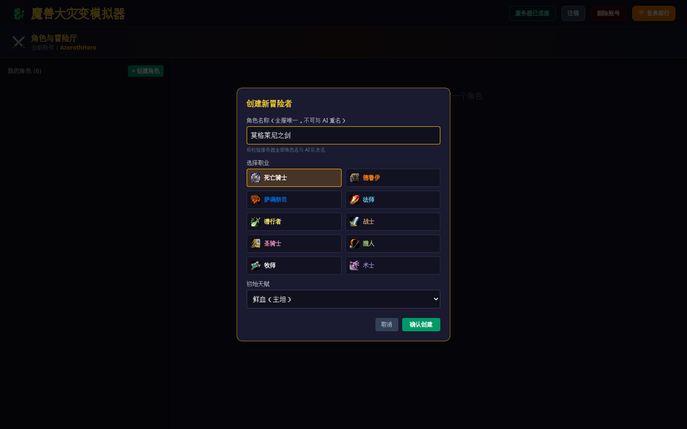
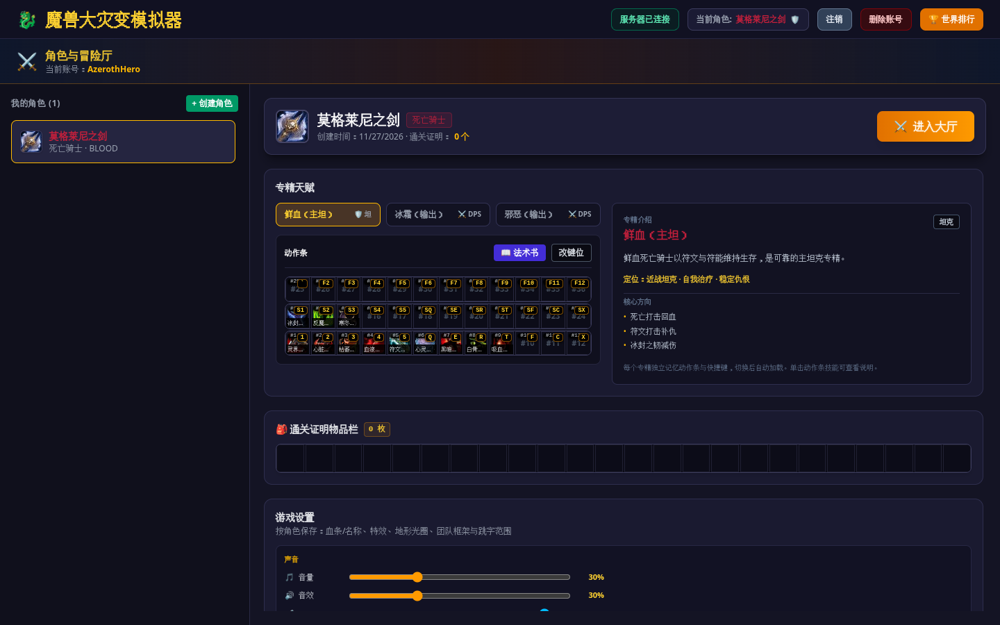
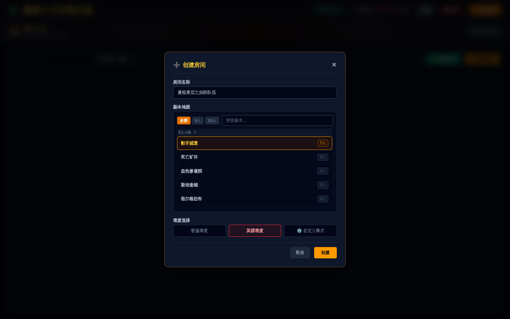
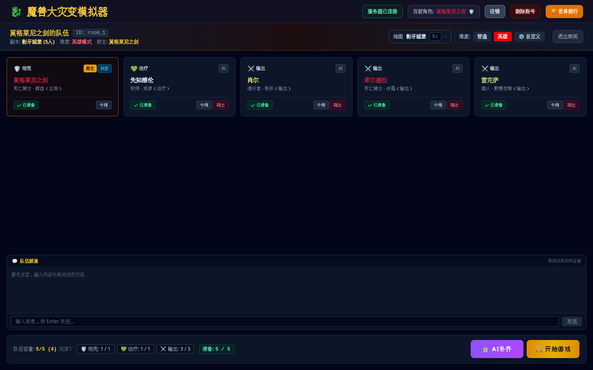
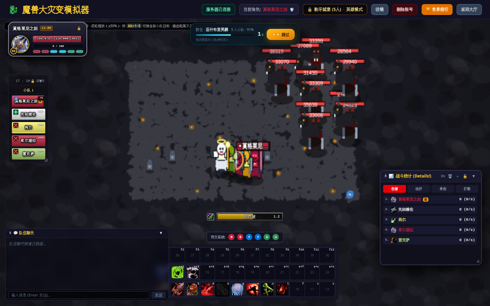
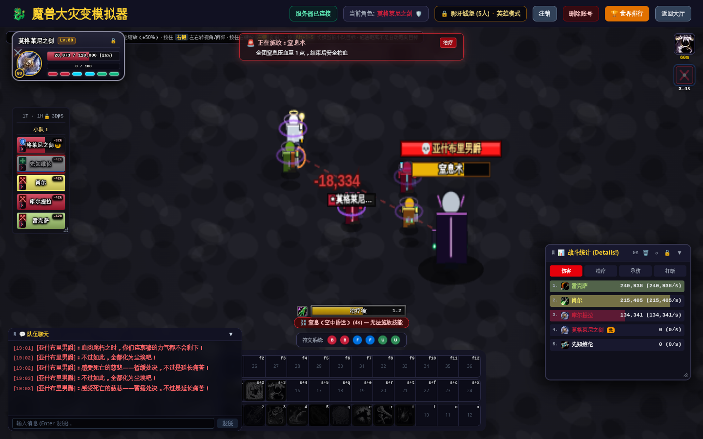

# 🐉 WoW-Mini — 魔兽世界：大灾变 4.3 团队副本与地下城模拟器 (WoW Cataclysm 4.3 Dungeon & Raid Simulator)

<div align="center">

**2.5D 战术走位 · 6 大副本 34 位首领 · 10 大职业 30 专精 · V2 混合权威多端联机 · 零硬编码规则驱动 AI 队友**

**2.5D Tactical Combat · 6 Dungeons & 34 Bosses · 10 Classes & 30 Specs · V2 Hybrid-Authority Multiplayer · Universal Rule-Driven AI Companions**

[中文介绍](#-项目简介-overview-zh) · [English Overview](#-english-overview) · [实机截图 Gallery](#-实机玩法截图-gameplay-screenshots) · [六大副本 34 首领](#-六大副本与-34-位首领矩阵-6-dungeons--34-bosses) · [十大职业 30 专精](#-十大英雄职业与-30-专精矩阵-10-classes--30-specializations) · [快速启动 Quick Start](#-快速启动-quick-start)

</div>

---

## 📸 实机玩法截图 (Gameplay Screenshots)

| 十大职业与 30 专精创角 (10 Classes & 30 Specs) | 冒险大厅与 36 键位/镜头设置 (Adventure Hall & Settings) |
| :---: | :---: |
|  |  |
| **六大副本大厅与难度倍率 (6-Dungeon Lobby & Scaling)** | **联机房间与一键 AI 补齐 (Party Room & AI Autofill)** |
|  |  |
| **2.5D 副本迷宫行进与六符文 HUD (2.5D Dungeon HUD)** | **首领战实机：DBM 预警与 Details! 统计 (Boss Encounter)** |
|  |  |

---

## 📖 项目简介 (Overview ZH)

**WoW-Mini (`@cata-raid-sim`)** 是一款基于 **TypeScript + React 19 + Node.js WebSocket + 纯逻辑确定性战斗引擎 (`@cata-raid-sim/engine`)** 构建的《魔兽世界：大灾变 (Cataclysm 4.3)》及经典旧世重制地下城/团队副本战术模拟器。

项目将经典 MMO 副本的核心乐趣——**主副资源循环、GCD 与施法状态机、坦克仇恨交接、治疗智能分诊、打断与驱散配合、首领时间轴转阶段与跑位分摊**——浓缩进轻量化、高响应的 2.5D 战术竞技场与迷宫副本中，既支持**多人实时 WebSocket 联机开荒**，也支持**单人带领 4 名或 19 名高智商 AI 队友**随时体验完整团本机制。

### ✨ 核心特性 (Key Highlights)

1. **🏰 六大完整副本 · 34 位全机制脚本首领**
   - **5 大经典五人本（1T + 1H + 3DPS）**：死亡矿井（6 首领）、影牙城堡（5 首领）、血色修道院（5 首领）、通灵学院（6 首领）、斯坦索姆（4 首领），支持走廊小怪群推进、迷宫地图与首领战无缝穿插。
   - **20 人史诗团队副本（2T + 4H + 14DPS）**：巨龙之魂（Dragon Soul，8 首领），完整还原莫卓克践踏双倍分摊、约萨希三色软泥融合优先级、哈格拉冰电导管连线、奥卓克希昂《英勇意志》位面规避、黑角甲板暮光冲击波、死亡之翼的背脊肌腱破甲（32% 血量锁）与死亡之翼的疯狂四台子古神寄生。
2. **⚔️ 十大英雄职业 · 30 专精 · 236 个归一化技能**
   - 完整覆盖 **死亡骑士、德鲁伊、萨满祭司、圣骑士、牧师、战士、潜行者、法师、术士、猎人** 全部 10 大职业与 30 个专精。
   - 深度还原专属主副资源状态机：**DK 6 符文独立 10 秒充能槽 + 符文能量**、**圣骑士 0~3 层神圣能量**、**潜行者/野德 0~5 星连击点**、**平衡德 -100~+100 日月蚀能量条**、**猎人集中值与稳固射击回能**、**战士怒气与萨满四系图腾槽**。
3. **🧠 零职业硬编码的通用规则驱动 AI (`SkillMetricEvaluator.ts`)**
   - 严禁按职业/技能名写死出招顺序！所有 AI 队友均通过统一的**预期吞吐估值公式 + 救急分诊权重 + 反刷覆盖阈值 (`ANTI_CLIP_DOT_HOT_THRESHOLD = 2800ms`) + 首领机制战术状态机**实时动态评分决策。
   - **AI 与真人完全同权**：AI 队友与真人玩家共用同一套 `CastLifecycle` 施法生命周期、GCD 锁、资源扣减与打断冷却，绝无作弊免蓝或无视 GCD 行为。
4. **🌐 V2 混合权威多端联机架构 (V2 Hybrid-Authority Netcode)**
   - **房主 (Host)** 运行完整 100ms 确定性 `RaidCombatEngine` Tick 循环并每 150ms 广播权威快照 (`v2_engine_snapshot`)；
   - **非房主客机 (Guest)** 本地运行自身技能 CD/GCD/资源扣减以实现 **0ms 按键手感**，将命中结算封装为 `v2_combat_effect` 帧并附带 `withNetworkVitals()` 资源快照回传房主，彻底消除跨端资源漂移。
5. **📊 内置 Details! 战斗统计与 DBM 首领预警系统**
   - 实时统计每位队员的伤害 (DPS)、治疗 (HPS)、承伤与打断次数；内置高危读条、点名分摊、转阶段护盾与全屏大招的 DBM 倒计时与声光提示。

---

## 🌍 English Overview

**WoW-Mini (`@cata-raid-sim`)** is a deterministic, full-stack **World of Warcraft: Cataclysm (4.3) & Classic Reworked Dungeon/Raid Tactical Simulator** built with **TypeScript, React 19, Node.js WebSockets, and an isomorphic combat engine (`@cata-raid-sim/engine`)**.

It distills the core tactical depth of WoW raiding—**primary/secondary resource state machines, GCD & cast/channel lifecycles, tank threat & mitigation, healer triage, interrupt/dispel rotations, and multi-phase boss mechanics**—into a responsive 2.5D tactical arena and dungeon crawler. Play solo with 4 or 19 rule-driven AI companions, or team up with friends in real-time multiplayer rooms.

### ✨ Architectural Highlights

- **6 Complete Instances & 34 Scripted Bosses**: 5 classic 5-man dungeons (*Deadmines, Shadowfang Keep, Scarlet Monastery, Scholomance, Stratholme*) with corridor trash waves + the 20-player *Dragon Soul* raid (*Morchok, Yor'sahj, Zon'ozz, Hagara, Ultraxion, Warmaster Blackhorn, Spine of Deathwing, Madness of Deathwing*).
- **10 Classes, 30 Specializations & 236 Spells**: Authentic dual-resource engines including Death Knight's 6 individual rune slots (`B/B/F/F/U/U`) + Runic Power, Paladin Holy Power (`0..3`), Rogue/Feral Combo Points (`0..5`), Balance Druid Solar/Lunar Eclipse (`-100..+100`), Hunter Focus regeneration, and Shaman Elemental Totems.
- **Universal Rule-Driven AI (`SkillMetricEvaluator.ts`)**: Zero hardcoded class rotations. AI companions dynamically evaluate every available spell on each 100ms tick based on expected DPS/HPS throughput, DoT/HoT anti-clipping thresholds (`2800ms`), resource efficiency, and boss mechanic awareness (e.g., saving burst for exposed tendons, switching to oozes/totems, or pre-casting heals during *Asphyxiate*).
- **11 Unified Skill Behavior & Network Sync Archetypes**: All 236 spells map cleanly onto 11 standardized lifecycle & network synchronization patterns (`ARCH-01` through `ARCH-11`), ensuring deterministic parity between Host, Guest, and AI actors.

---

## 🏰 六大副本与 34 位首领矩阵 (6 Dungeons & 34 Bosses)

| 副本 ID (Instance) | 名称 (CN / EN) | 编制 (Size) | 首领数 (Bosses) | 核心首领与标志性机制 (Signature Bosses & Mechanics) |
| :--- | :--- | :---: | :---: | :--- |
| `deadmines` | **死亡矿井**<br/>*The Deadmines* | 5 人<br/>(1T/1H/3D) | **6** | 格拉布托克（冰火双拳转阶段）、赫利克斯、死神5000、撕心狼将军、绿皮队长、**凡妮莎·范克里夫**（梦魇毒药 + 船舱爆破） |
| `shadowfang_keep` | **影牙城堡**<br/>*Shadowfang Keep* | 5 人<br/>(1T/1H/3D) | **5** | **亚什布里男爵**（窒息术全团锁 1 血 + 痛苦与折磨打断）、席瓦莱恩男爵（诅咒狼魂召唤）、春谷指挥官、沃登勋爵（冰毒试剂瓶）、**高弗雷勋爵**（诅咒子弹 + 弹幕散射回避） |
| `scarlet_monastery` | **血色修道院**<br/>*Scarlet Monastery* | 5 人<br/>(1T/1H/3D) | **5** | 审讯员韦斯帕尔、训犬师洛克希、奥法师杜安（奥术气泡护盾 + 烈焰风暴）、赫洛德（旋风斩免伤反伤规避）、**莫格莱尼与怀特迈恩**（群体复活 + 深度睡眠男女双王同场） |
| `scholomance` | **通灵学院**<br/>*Scholomance* | 5 人<br/>(1T/1H/3D) | **6** | 詹迪斯·巴罗夫（幻象分身识别）、血骨傀儡（骨甲尖刺）、莉莉安·沃斯（灵魂黑焰追击）、克尔苏加德教授、瑟尔林·卡斯迪诺夫教授、**黑暗院长加丁**（强制传送门锁人 + 暗影囚笼） |
| `stratholme` | **斯坦索姆**<br/>*Stratholme* | 5 人<br/>(1T/1H/3D) | **4** | 不可宽恕者、安娜丝塔丽男爵夫人（精神控制附体）、苍白的玛勒基、**瑞文戴尔男爵**（亡灵卫兵献祭回血 + 死亡凋零光环） |
| `dragon_soul` | **巨龙之魂**<br/>*Dragon Soul* | 20 人<br/>(2T/4H/14D) | **8** | **莫卓克**（践踏双倍伤与黑血躲避）、**约萨希**（三色软泥融合击杀优先级）、**督军佐诺兹**（虚空球弹跳增伤）、**哈格拉**（冰霜/闪电双相位导管）、**奥卓克希昂**（暮光审判与《英勇意志》）、**黑角**（暮光冲击波分摊）、**死亡之翼的背脊**（32% 血量锁 + 9 层核爆掀甲打肌腱）、**死亡之翼的疯狂**（四龙台子古神寄生与源质箭） |

---

## ⚔️ 十大英雄职业与 30 专精矩阵 (10 Classes & 30 Specializations)

| 职业 (Class) | 主/副资源机制 (Resource Machine) | 三大专精 (3 Specializations & Roles) | 代表性特殊引擎钩子 (Bespoke Engine Hooks) |
| :--- | :--- | :--- | :--- |
| **死亡骑士**<br/>`DK` | **6 独立符文槽 (`B/B/F/F/U/U`, 10s CD)** + **符文能量 (0~100)** | 🩸 鲜血 (Tank)<br/>❄️ 冰霜 (DPS)<br/>☠️ 邪恶 (DPS) | `spendDkResourcesForSpell()` 双系复合扣费；《灵界打击》动态回血；《符文武器增效》瞬间激活全 6 符文 + 25 符能；邪恶食尸鬼/天鬼召唤 |
| **德鲁伊**<br/>`DRUID` | 恢复：**法力**<br/>平衡：**法力 + 日月蚀 (-100..+100)**<br/>野性：**能量 + 连击点 (0..5)** | 🌿 恢复 (Healer)<br/>🌙 平衡 (DPS)<br/>🐾 野性 (DPS) | `isValidLifebloomTarget()` 严格限制《生命之绽》仅允许挂在坦克身上且叠满 3 层绽放；平衡星涌术推进日月蚀；野性 5 星《割裂》快照 |
| **萨满祭司**<br/>`SHAMAN` | **法力 (0~1000)** + **大地/火焰/水/空气图腾与武器灌注** | 🌊 恢复 (Healer)<br/>⚡ 元素 (DPS)<br/>🔨 增强 (DPS) | `applyRaidLustBuff()`《嗜血》全团 +30% 急速并施加 10 分钟《心满意足》；《灵魂链接图腾》全团生命百分比均摊；元素《熔岩爆裂》对烈焰震击必爆 |
| **圣骑士**<br/>`PALADIN` | **法力 (0~1000)** + **神圣能量 (0~3 Holy Power)** | ✨ 神圣 (Healer)<br/>🛡️ 防护 (Tank)<br/>⚖️ 惩戒 (DPS) | 《圣光道标》50% 折射治疗；《圣疗术》回满目标但施加《自律》；3 豆《荣耀圣言 / 圣殿骑士的裁决》全额倾泻神圣能量 |
| **牧师**<br/>`PRIEST` | **法力 (0~1000)** + **暗影宝珠 / 心灵融化联动** | 🛡️ 戒律 (Healer)<br/>🕊️ 神圣 (Healer)<br/>🌑 暗影 (DPS) | 《真言术：盾》施加 `absorbs` 护盾池与 15 秒《虚弱灵魂》；《痛苦压制 / 守护之魂》外置救急减伤；暗牧《精神鞭笞》3 段引导跳伤 |
| **战士**<br/>`WARRIOR` | **怒气 (0~100 Rage)**（普攻/招架产怒 + 技能消耗） | 🛡️ 防护 (Tank)<br/>🗡️ 武器 (DPS)<br/>🔥 狂怒 (DPS) | `bumpMaxHp()`《破釜沉舟》临时提升 30% 生命上限并等比抬升当前血量；《盾牌格挡 / 盾墙》减伤；20% 斩杀线《斩杀》高倍爆发 |
| **潜行者**<br/>`ROGUE` | **能量 (0~100, 10/s)** + **连击点 (0~5 Combo Points)** | ⚔️ 战斗 (DPS)<br/>🧪 刺杀 (DPS)<br/>🌑 敏锐 (DPS) | 攒星技 (`comboPointsGain`) 与终结技 (`requiresComboPoints`) 按 `1..5` 星线性/阶梯放大；《切割》攻速光环；《杀戮盛筵 / 暗影之舞》爆发窗口 |
| **法师**<br/>`MAGE` | **法力 (0~1000)** + **奥术充能 / 炽热连击 / 冰冷智慧** | 🔥 火焰 (DPS)<br/>❄️ 冰霜 (DPS)<br/>🔮 奥术 (DPS) | 《时间扭曲》与嗜血共享全团急速与心满意足锁；火法《燃烧》叠算 DoT 快照；奥法《唤醒》引导回蓝与《奥术冲击》控蓝循环 |
| **术士**<br/>`WARLOCK` | **法力 (0~1000)** + **灵魂碎片 + 生命分流血转蓝** | 💀 痛苦 (DPS)<br/>😈 恶魔学识 (DPS)<br/>🔥 毁灭 (DPS) | 《生命分流》扣除自身生命转化为法力；痛苦三 DoT +《吸取灵魂》斩杀引导；恶魔《恶魔变形》光环与末日守卫召唤 |
| **猎人**<br/>`HUNTER` | **集中值 (0~100 Focus)**（自然恢复 +《稳固/眼镜蛇射击》主动回能） | 🐻 野兽控制 (DPS)<br/>🏹 射击 (DPS)<br/>🪤 生存 (DPS) | 彻底告别旧版蓝条，采用大灾变 4.3 集中值闭环；《误导》转移仇恨给主坦；《宁神射击》驱散首领激怒；生存《黑箭》与《爆炸射击》联动 |

---

## 🧩 11 类技能行为模式与网络通信交互体系 (11 Skill Behavior & Network Archetypes)

引擎将 10 大职业的全部 236 个技能归纳为 **11 种标准化行为与网络同步原型**：

1. **`ARCH_INSTANT_DIRECT`**：瞬发单体直伤/直疗（如《冰霜打击》《十字军打击》《神圣震击》）
2. **`ARCH_CAST_DIRECT`**：读条单体直伤/直疗（如《火球术》《强效治疗术》《稳固射击》）
3. **`ARCH_CHANNELED_TICK`**：引导分段跳伤/跳疗（如《精神鞭笞》《苦修》《吸取灵魂》《宁静》）
4. **`ARCH_DOT_HOT_SNAPSHOT`**：持续周期 DoT/HoT 与反刷覆盖保护（如《痛》《回春术》《生命之绽》）
5. **`ARCH_ABSORB_AND_DEFENSIVE`**：吸收护盾与减伤免死大招（如《真言术：盾》《盾墙》《破釜沉舟》）
6. **`ARCH_BUILDER_GENERATOR`**：副资源构建与主动回能（如《影袭》《神圣打击》《生命分流》）
7. **`ARCH_FINISHER_SPENDER`**：副资源终结技与复合扣费（如《刺骨》《荣耀圣言》《湮没》《星涌术》）
8. **`ARCH_AOE_CLEAVE_PULSE`**：多目标顺劈与范围脉冲（如《神圣风暴》《治疗链》《暴风雪》《旋风斩》）
9. **`ARCH_INTERRUPT_DISPEL_THREAT`**：打断、进攻/防御驱散与强制嘲讽（如《心灵冰冻》《风剪》《黑暗命令》）
10. **`ARCH_SUMMON_TOTEM_GUARDIAN`**：召唤生物、萨满图腾与守护者（如《亡者大军》《治疗之泉图腾》《召唤末日守卫》）
11. **`ARCH_BESPOKE_ENGINE_HOOKS`**：跨系统特殊钩子与全团战略大招（如《嗜血/时间扭曲》《圣光道标》《灵魂链接图腾》）

---

## 🗂️ 仓库目录结构 (Repository Architecture)

```text
wow-mini/
├── R0_新电脑安装并启动.bat         # Windows 一键初始化依赖并启动前后端 (One-click setup & launch)
├── R1_启动.bat                    # Windows 日常快速启动脚本 (Fast daily launcher)
├── R2_停止服务.bat                # 一键清理后台 Node 进程 (Stop background services)
├── ART/
│   └── resources/                 # 职业/技能图标、副本背景、音频与美术清单 (Art & icon assets)
├── DOCS/
│   ├── screenshots/               # 实机玩法截图 (Gameplay screenshots)
│   └── ...                        # 架构设计、混合权威联机协议与职业审计文档 (Design & netcode docs)
└── DEV/
    └── packages/
        ├── engine/                # @cata-raid-sim/engine — 纯 TypeScript 确定性战斗与 AI 引擎 (Isomorphic combat engine)
        │   └── src/
        │       ├── CombatEngine.ts          # 核心 Tick 调度、首领时间轴、V2 网络同步与特殊技能钩子
        │       ├── ai/SkillMetricEvaluator.ts # 零硬编码通用规则驱动 AI 评分器
        │       └── data/
        │           ├── ClassRegistry.ts     # 10 大职业 30 专精 236 技能归一化注册表
        │           ├── raidCatalog.ts       # 6 大副本与 20 人巨龙之魂编排目录
        │           └── dungeons5man.ts      # 5 大经典五人本 26 位首领与小怪群配置
        ├── server/                # @cata-raid-sim/server — WebSocket 联机房间、账号存档与排行榜服务
        └── web/                   # @cata-raid-sim/web — React 19 + 2.5D 战斗舞台 + Details! + DBM 前端
```

---

## 🚀 快速启动 (Quick Start)

### 方式一：Windows 一键脚本 (Windows 1-Click Batch Scripts)

1. 确保已安装 **Node.js 20+**（推荐 LTS 版本）。
2. 首次克隆仓库后，双击运行根目录下的 **`R0_新电脑安装并启动.bat`**（自动安装依赖、编译 `engine` 并拉起服务端与前端页面）。
3. 后续日常游玩直接双击 **`R1_启动.bat`**，结束游玩双击 **`R2_停止服务.bat`**。

### 方式二：跨平台命令行启动 (Manual CLI for macOS / Linux / Windows)

```bash
# 1. 进入 DEV 目录并安装依赖 (Install workspace dependencies)
cd DEV
npm install

# 2. 编译核心战斗引擎 (Build @cata-raid-sim/engine)
npm run build --workspace=@cata-raid-sim/engine

# 3. 启动联机与存档后端服务 (Start WebSocket & HTTP server on port 3001)
npx tsx packages/server/src/index.ts

# 4. 新开终端启动前端 Web 客户端 (Start Vite web client on port 5173)
npx vite packages/web --port 5173
```

启动后在浏览器访问 `http://localhost:5173` 即可注册账号、创建十大职业角色并进入六大副本开荒！

---

## 🧪 自动化验证与回归测试 (Automated QA & Regression Suite)

项目在 `DEV/packages/engine/scripts/` 下内置了完整的无头战斗回归与全职业模拟套件：

```bash
# 运行核心引擎回归测试 (Run deterministic engine regression suite)
npm test --workspace=@cata-raid-sim/engine
```

---

## 📄 开源许可与致敬 (License & Credits)

本项目为面向战术机制研究、AI 协同算法验证与混合权威网络同步架构展示的非商业开源致敬项目。《魔兽世界》(World of Warcraft) 及相关职业、副本与首领设定版权归 **Blizzard Entertainment (暴雪娱乐)** 所有。
